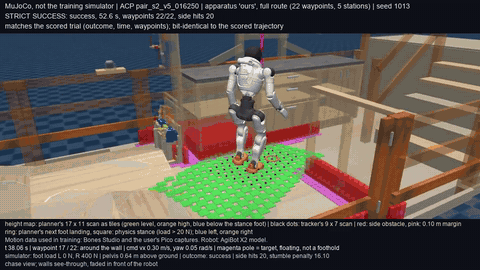
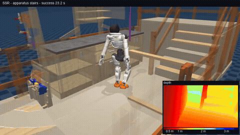
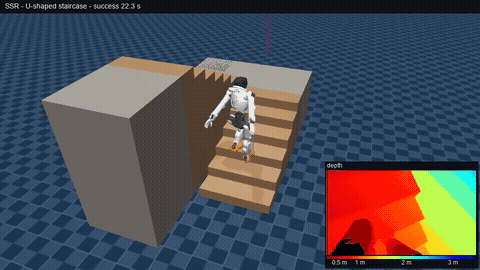

# perception-agents

A standing team of Claude agents that trains perceptive locomotion for the **AgiBot X2** on the IEEE loco-manipulation apparatus,
with three methods run side by side. The final score is the walk on both humanoid-challenge apparatuses, ours and NIST's,
which are held out of training (`docs/EVAL.md`). This repo is the team's memory: roles, node map, shared-filesystem layout, the eval
definition and the current status. A new session can pick the work up from here alone.

**Goal (set by the user, 2026-11-11):** take the apparatus walk from about 25% success (the user's figure; the first job of the eval
agent is to re-measure it under `docs/EVAL.md`) to close to 99%. X2 only for this round.

## Results so far (2026-11-15)

All numbers are from the held-out MuJoCo apparatus eval (`docs/EVAL.md`), not the training simulator. Renders: MuJoCo,
not the training simulator.

| Track | Best checkpoint | Full apparatus route (ours) | NIST apparatus | Notes |
|---|---|---|---|---|
| ACP (contact planner + tracker) | `pair_s3_v2_023000` (stage 3) | **198/200 (99%)**; 193/200 (96.5%) on 200 fresh seeds | 155/200 (77.5%) | perfect height map (simulator); falls on NIST mostly on the ramps |
| Hiking in the Wild (X2 port) | `x2_parkour_v4_24500` (v9) | not yet qualified (legs 48/49/42/37/41 of 50) | - | depth camera; stair refusals fixed (FINDINGS H8-H9) |
| SSR | `r7_v20_final_26000` | not qualified (legs 49/50/49/44/5) | - | stopped; refuses high stairs (FINDINGS E8-E8c) |

| ACP: full route | ACP: homes (big block, small blocks) |
|---|---|
|  |  |
| **Hiking: apparatus stairs (leg 5)** | **Hiking: extended map, L-shaped stairs** |
|  |  |
| **SSR: apparatus stairs (leg 5)** | **SSR: extended map, C-shaped stairs** |
|  |  |

### Training setup and compute

Each track trained on its own Nebius node with **one NVIDIA RTX PRO 6000 Blackwell (96 GB)**; evaluation ran on a desktop CPU
(MuJoCo, chunked and parallel). All three started on 2026-11-11 about 20:00 UTC.

| | ACP | Hiking in the Wild (X2) | SSR |
|---|---|---|---|
| Simulator | MuJoCo Warp | Isaac Lab (PhysX), InstinctLab | MuJoCo Warp |
| Parallel robots | 36,000 | 8,192 | 8,192 |
| Steps per robot per iteration | 24 | 24 | 24 |
| Samples per iteration | 864,000 | 196,608 | 196,608 |
| PPO | 5 epochs, 8 minibatches, lr 1e-4 (KL-adaptive) | WasabiPPO + AMP discriminator, 5 epochs, 4 minibatches, lr 1e-3 (KL-adaptive, target 0.01) | 5 epochs, 4 minibatches, lr 5e-4 x 4 optimisers (KL-adaptive) |
| Throughput | about 7.4 s/iteration (stage 1), 11.5-14 s (stages 2-3); 60-117k env-steps/s | about 9.6-9.8 s/iteration | about 6.5-6.8 s/iteration, about 30k samples/s |
| Policy input (terrain) | height scans (planner 17x11, tracker 9x7) | chest depth camera, 8-frame history | chest depth camera + GRU |
| Iterations reached | about 26,600 (stage 1 -> 2 -> 3; best at 23,000) | 27,000 (best at 24,500) | 32,750 (stopped) |
| Wall-clock time | about 91.5 h (to 2026-11-15 15:32 UTC, paused) | about 91.5 h (paused 15:30 UTC) | about 82 h (stopped 06:01 UTC) |

Total: about **265 GPU-hours** on three RTX PRO 6000 GPUs, including restarts, rollbacks and abandoned segments. Every
segment, its settings and why it changed are in `docs/runs/ledger_<track>.md`; the single-run recipes are in
`docs/runs/recipe_<track>.md`.

Review page (status, training curves, paper-vs-code audits, renders): open `docs/site/index.html` (self-contained; the training
curves are in `docs/site/training_plots.html`).

Model checkpoints: see "Models" below.

## Models

Policy exports with model cards on Hugging Face (simulation-trained; not yet tested on the real robot):

| Track | Hugging Face | Checkpoint | Licence |
|---|---|---|---|
| ACP (planner + tracker) | [tinkerbuggy/x2-acp-contact-planner-tracker](https://huggingface.co/tinkerbuggy/x2-acp-contact-planner-tracker) | `pair_s3_v2_023000` (99% route) | Apache 2.0 |
| Hiking in the Wild (X2) | [tinkerbuggy/x2-hiking-in-the-wild](https://huggingface.co/tinkerbuggy/x2-hiking-in-the-wild) | iteration 24,500 (best) | CC BY-NC 4.0 |
| SSR | [tinkerbuggy/x2-ssr](https://huggingface.co/tinkerbuggy/x2-ssr) | `r7_v20x_032000` (final) | CC BY-NC 4.0 |

Each repo holds the ONNX / numpy weights, the full training checkpoint and configs under `checkpoint/` (for fine-tuning), `adapter_card.json` (input and output specification) and `obs_check.npz` (recorded
inputs and outputs). The evaluation adapters in `eval/adapters/` show how to run them in MuJoCo.

**Data credits.** Motion references include **BONES-SEED by Bones Studio** (retargeted to the X2) and the author's own Pico
captures. Hiking and SSR also use the *Hiking in the Wild* (InstinctLab) release, licensed CC BY-NC 4.0, so those two models
are non-commercial. Methods: Adaptive Contact Planning (arXiv 2610.31608), Hiking in the Wild (arXiv 2601.07718), SSR (arXiv 2605.30770).

## The team

| Role | Agent definition | Where it works | Owns |
|---|---|---|---|
| Coordinator | `CLAUDE.md` (the main session, opened in this repo) | the user's desktop | plan, priorities, status, talking to the user |
| ACP track | `.claude/agents/acp-track.md` | node `acp` | adaptive contact planning on the X2 (`gwbc-v6`, `scripts/acp`) |
| SSR track | `.claude/agents/ssr-track.md` | node `ssr` | SSR on the X2 (`ssr-x2`) |
| Hiking track | `.claude/agents/hiking-track.md` | node `hiking` | Hiking in the Wild ported to the X2 (`hiking-in-the-wild`) |
| Eval monitor | `.claude/agents/eval-monitor.md` | reads all three; runs evals on the track's own node when it is idle, or on the desktop CPU (MuJoCo) | the common apparatus eval, renders, reports to the coordinator |

Nodes are in `config/nodes.json`. Each track has one RTX 6000 node on Nebius and its own code checkout; all three mount one
shared filesystem (`docs/SHARED_FS.md`).

## Rules that keep the three tracks apart

- One track, one node, one code tree (`/mnt/filesystem-g4/tracks/<track>/code`), one Python environment, one run folder. A track never edits
  another track's tree, and never imports from it.
- Anything a track wants from another (a motion file, a terrain, a checkpoint) is **copied** through `/mnt/filesystem-g4/exchange/` with a
  note in `state/STATUS.md`; never linked.
- Shared, read-only inputs live in `/mnt/filesystem-g4/data` (motions, apparatus CAD rasters, terrain generators). Changes to them go
  through the coordinator.
- Every track is scored by the **same** eval (`docs/EVAL.md`), run by the eval monitor, not by the track itself.

## Starting or resuming the team

**Lost the session? Follow `docs/RUNBOOK.md`.** The user's rules and decisions are in `docs/USER_RULES.md`; every agent reads that file first.

1. Open a Claude Code session in this folder; it becomes the coordinator (`CLAUDE.md`).
2. Read `state/STATUS.md` (status and the decisions log).
3. Check the nodes: `bash scripts/node_check.sh`.
4. The user's review dashboard is https://claude.ai/artifact/JaZDeLFXXN28HLMd1Sia3V; its data files and page are in `dashboard/` (update the JSON, upload, rewrite the store documents).
5. Start or resume each track agent with its definition; each one first reads its own `state/<track>.md`.

## Standing constraints (from the user)

- Nothing is bought; never search Amazon. Bones Studio credit on shown results; no dataset clip names on screen.
- Robot videos come from the simulator's own camera and are checked against simulator data; anything else is labelled.
- Do not commit or push unless the user asks. Large downloads are rate-capped and need the user's okay.
- Long runs go through a supervisor with stall detection and auto-resume; one GPU job per node; every shell command has a timeout.
- Do not wait on the user: take the recommended option, record it in `state/STATUS.md`, keep going.
