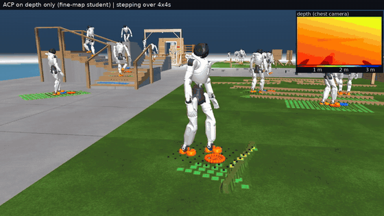
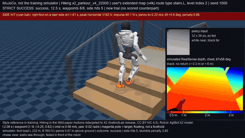

# x2-perception

Perceptive locomotion for the **AgiBot X2** humanoid, trained in simulation for the IEEE humanoid-challenge
loco-manipulation apparatus. Several approaches, each ported to the X2 and trained on one GPU, all scored by the same
held-out MuJoCo eval on an apparatus that never appears in training. Simulation-trained; real-robot deployment is in progress.

## Approaches and results

Success = the full apparatus route (22 waypoints: door, two 4x4s, ramps, wall, stairs, five buttons) without a fall
([eval definition](docs/EVAL.md)).

| Approach | Terrain input | Our apparatus | NIST apparatus |
|---|---|---|---|
| **ACP** (adaptive contact planning) | simulator height scans | **198/200 (99%)** | 155/200 (77.5%) |
| **ACP on depth** (ACP + fine-map depth student) | chest depth camera only | **46/50 (92%)**, = ACP on the same seeds | - |
| **Hiking in the Wild** (X2 port) | chest depth camera | not yet qualified | - |
| **SSR** | chest depth camera + GRU | not qualified (refuses high stairs) | - |

## Renders

**ACP on depth: 62 X2s on the terrain park, then the full apparatus route** ([full film](docs/media/acp_depth_park.mp4))

| ACP: full apparatus route | ACP: homes (big block, small blocks) |
|---|---|
|  |  |
| **Hiking: apparatus stairs** | **Hiking: L-shaped staircase** |
|  |  |
| **SSR: apparatus stairs** | **SSR: U-shaped staircase** |
|  |  |

## More

- **Models and weights:** [ACP](https://huggingface.co/tinkerbuggy/x2-acp-contact-planner-tracker) ·
  [Hiking](https://huggingface.co/tinkerbuggy/x2-hiking-in-the-wild) · [SSR](https://huggingface.co/tinkerbuggy/x2-ssr)
  on Hugging Face; code, recipes and ledgers in [`models/`](models/) ([ACP](models/acp/), [ACP on depth](models/acp_depth/),
  [Hiking](models/hiking/), [SSR](models/ssr/))
- **Run the eval, fine-tune, repo layout:** [docs/USAGE.md](docs/USAGE.md)
- **Training setup and compute** (about 265 GPU-hours): [docs/TRAINING.md](docs/TRAINING.md)
- **Eval definition:** [docs/EVAL.md](docs/EVAL.md) · **What went wrong and how it was fixed:** [docs/FINDINGS.md](docs/FINDINGS.md)
- **Depth student plan and results:** [docs/TODO_depth_to_heightmap.md](docs/TODO_depth_to_heightmap.md)
- **Real-robot deployment:** [Hiking](deploy/hiking/PLAN.md) · [ACP](deploy/acp/PLAN.md) ·
  [chest camera mount](docs/hardware/chest_camera_mount/)
- **Review page** (status, training curves, audits): [docs/site/index.html](docs/site/index.html)
- **How this was built** (a team of Claude agents): [agentic/README.md](agentic/README.md)

**Licences and credits.** ACP: Apache 2.0. Hiking and SSR use the *Hiking in the Wild* (InstinctLab) release, CC BY-NC 4.0,
so those two are non-commercial. Motion data: BONES-SEED by Bones Studio and the author's Pico captures
([terrain-park](https://github.com/meetsitaram/terrain-park)); details in [docs/DATA.md](docs/DATA.md). Methods: Adaptive
Contact Planning (arXiv 2610.31608), Hiking in the Wild (arXiv 2601.07718), SSR (arXiv 2605.30770).
