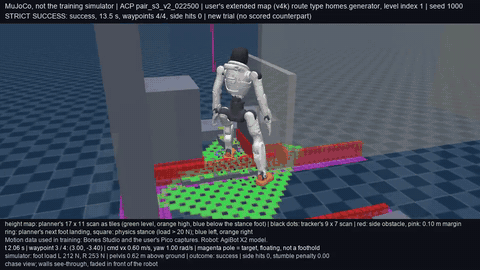
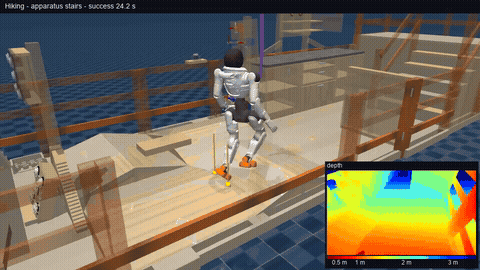

# x2-perception

Three perceptive locomotion policies for the **AgiBot X2** humanoid, trained in simulation for the IEEE humanoid-challenge
loco-manipulation apparatus: **ACP** (adaptive contact planning, height scans), **Hiking in the Wild** (depth camera) and
**SSR** (depth camera + GRU), each ported to the X2 and trained on one GPU. All three are scored by the same held-out MuJoCo
eval on two apparatuses, ours and NIST's, which never appear in training ([`docs/EVAL.md`](docs/EVAL.md)). Weights and full
training states are on Hugging Face; code, recipes and run ledgers for each model are in [`models/`](models/). The models are
simulation-trained and not yet tested on the real robot.

## Results so far (2026-11-15)

All numbers are from the held-out MuJoCo apparatus eval ([`docs/EVAL.md`](docs/EVAL.md)), not the training simulator. Renders:
MuJoCo, not the training simulator.

| Model | Best checkpoint | Full apparatus route (ours) | NIST apparatus | Notes |
|---|---|---|---|---|
| ACP (contact planner + tracker) | `pair_s3_v2_023000` (stage 3) | **198/200 (99%)**; 193/200 (96.5%) on 200 fresh seeds | 155/200 (77.5%) | perfect height map (simulator); falls on NIST mostly on the ramps |
| Hiking in the Wild (X2 port) | `x2_parkour_v4_24500` (v9) | not yet qualified (legs 48/49/42/37/41 of 50) | - | depth camera; stair refusals fixed (FINDINGS H8-H9) |
| SSR | `r7_v20_final_26000` | not qualified (legs 49/50/49/44/5) | - | stopped; refuses high stairs (FINDINGS E8-E8c) |

| ACP: full apparatus route | ACP: homes (big block, small blocks) |
|---|---|
|  |  |
| **Hiking: apparatus stairs (leg 5)** | **Hiking: L-shaped staircase (extended map)** |
|  |  |
| **SSR: apparatus stairs (leg 5)** | **SSR: U-shaped staircase (extended map)** |
|  |  |

The Hiking staircase clip is from checkpoint 26,500.

Review page (status, training curves, paper-vs-code audits, renders): open [`docs/site/index.html`](docs/site/index.html)
(self-contained; the training curves are in `docs/site/training_plots.html`).

## Training setup and compute

Each model trained on its own Nebius node with **one NVIDIA RTX PRO 6000 Blackwell (96 GB)**; evaluation ran on a desktop CPU
(MuJoCo, chunked and parallel). All three started on 2026-11-11 about 20:00 UTC.

| | ACP | Hiking in the Wild (X2) | SSR |
|---|---|---|---|
| Simulator | MuJoCo Warp | Isaac Lab (PhysX), InstinctLab | MuJoCo Warp |
| Parallel robots | 36,000 | 8,192 | 8,192 |
| Steps per robot per iteration | 24 | 24 | 24 |
| Samples per iteration | 864,000 | 196,608 | 196,608 |
| PPO | 5 epochs, 8 minibatches, lr 1e-4 (KL-adaptive) | WasabiPPO + AMP discriminator, 5 epochs, 4 minibatches, lr 1e-3 (KL-adaptive, target 0.01) | 5 epochs, 4 minibatches, lr 5e-4 x 4 optimisers (KL-adaptive) |
| Throughput | about 7.4 s/iteration (stage 1), 11.5-14 s (stages 2-3); 60-117k env-steps/s | about 9.6-9.8 s/iteration | about 6.5-6.8 s/iteration, about 30k samples/s |
| Policy input (terrain) | height scans (planner 17x11, tracker 9x7) | chest depth camera, 8-frame history | chest depth camera + GRU |
| Iterations reached | about 26,600 (stage 1 -> 2 -> 3; best at 23,000) | 27,000 (best at 24,500) | 32,750 (stopped) |
| Wall-clock time | about 91.5 h (to 2026-11-15 15:32 UTC, paused) | about 91.5 h (paused 15:30 UTC) | about 82 h (stopped 06:01 UTC) |

Total: about **265 GPU-hours** on three RTX PRO 6000 GPUs, including restarts, rollbacks and abandoned segments. Every
segment, its settings and why it changed are in `models/<model>/LEDGER.md`; the single-run recipes are in
`models/<model>/RECIPE.md`.

## Models

Policy exports with model cards on Hugging Face (simulation-trained; not yet tested on the real robot):

| Model | Hugging Face | Checkpoint | Licence | In this repo |
|---|---|---|---|---|
| ACP (planner + tracker) | [tinkerbuggy/x2-acp-contact-planner-tracker](https://huggingface.co/tinkerbuggy/x2-acp-contact-planner-tracker) | `pair_s3_v2_023000` (99% route) | Apache 2.0 | [`models/acp/`](models/acp/) |
| Hiking in the Wild (X2) | [tinkerbuggy/x2-hiking-in-the-wild](https://huggingface.co/tinkerbuggy/x2-hiking-in-the-wild) | iteration 24,500 (best) | CC BY-NC 4.0 | [`models/hiking/`](models/hiking/) |
| SSR | [tinkerbuggy/x2-ssr](https://huggingface.co/tinkerbuggy/x2-ssr) | `r7_v20x_032000` (final) | CC BY-NC 4.0 | [`models/ssr/`](models/ssr/) |

Each Hugging Face repo holds the ONNX / numpy weights, the full training checkpoint and configs under `checkpoint/` (for
fine-tuning), `adapter_card.json` (input and output specification) and `obs_check.npz` (recorded inputs and outputs). The
evaluation adapters in [`eval/adapters/`](eval/adapters/) show how to run them in MuJoCo.

**Data credits.** Motion references include **BONES-SEED by Bones Studio** (retargeted to the X2) and the author's own Pico
captures ([meetsitaram/terrain-park](https://github.com/meetsitaram/terrain-park): raw takes in `data/2026-10-29`,
`data/2026-10-30`; X2 training sets in `data/train_sets`; style clips in `data/style`). Hiking and SSR also use the *Hiking in
the Wild* (InstinctLab) release, licensed CC BY-NC 4.0, so those two models are non-commercial. Methods: Adaptive Contact
Planning (arXiv 2610.31608), Hiking in the Wild (arXiv 2601.07718), SSR (arXiv 2605.30770). Data provenance:
[`docs/DATA.md`](docs/DATA.md).

## Run a model in the MuJoCo eval

The eval runs on CPU with Python, `mujoco`, `numpy` and `onnxruntime`. It needs two inputs that are not in this repo: the X2
MJCF (`PA_ROBOT_DIR` = a folder holding `mjcf/x2_ultra.xml`) and the apparatus rasters and routes (`PA_APPARATUS_DIR`, or
`eval/data/apparatus/`); see [`docs/DATA.md`](docs/DATA.md). The NIST apparatus files are not published.

1. Download a model from Hugging Face into a folder, e.g. `huggingface-cli download tinkerbuggy/x2-ssr --local-dir hf/x2-ssr`.
2. Point the model's adapter at that folder and run the harness (one attempt per seed at the full apparatus route) or the
   station-to-station legs:

```bash
# ACP: folder with actor.npz, planner_attn.onnx, adapter_card.json
ACP_HANDOVER_DIR=hf/x2-acp-contact-planner-tracker ACP_GOAL_R=0.2 ACP_LOOKAHEAD=0.3 X2_EXCLUDE_PAIRS=hip \
  python eval/harness.py --adapter acp:ACPHandover --apparatus ours --trials 10 --out eval/out/acp_route

# Hiking: folder with policy.onnx, 0-depth_encoder.onnx, adapter_card.json, obs_check.npz
HIKING_HANDOVER_DIR=hf/x2-hiking-in-the-wild HIKING_CMD=card X2_EXCLUDE_PAIRS=hip \
  python eval/legs.py --adapter hiking:HikingHandover --apparatus ours --trials 50 --out eval/out/hiking_legs

# SSR: folder with policy.onnx, adapter_card.json, obs_check.npz
SSR_HANDOVER_DIR=hf/x2-ssr SSR_CMD=standard X2_EXCLUDE_PAIRS=hip \
  python eval/legs.py --adapter ssr:SSRHandover --legs 5 --trials 20 --out eval/out/ssr_leg5
```

`eval/harness.py` options: `--adapter <module>:<Class>` (or `zero`, `stand`), `--apparatus ours|nist|flat`, `--trials N`,
`--seed0 S`, `--protocol randomised|nominal`, `--seconds T`, `--stand`, `--kinematic` (route check without physics),
`--keep-traj picked|all`, `--wall-limit S`, `--label TEXT`, `--out DIR` (required). `eval/legs.py` takes `--adapter`, `--out`,
`--apparatus`, `--legs 1 2 ...`, `--trials` (default 50), `--seed0`, `--wall-limit`, `--label`, `--chunk K --chunk-size N`.
Output: `results.json` (every trial), `summary.json` (the table row) and `traj/<seed>.npz`, which `eval/render.py` turns into
videos. The environment variables above are the settings the automatic scorer uses (`eval/autoscore/autoscore.py`); every
adapter's other options are in its module docstring. Training-terrain courses: `eval/ladder.py`.

## Fine-tune

Each model folder has the training code, the recipe and the ledger, and its README says how to resume from the Hugging Face
`checkpoint/`:

- ACP: [`models/acp/`](models/acp/) - MuJoCo Warp trainer in `code/`, stage 3 resumed from `checkpoint/ckpt_023000.pt`.
- Hiking in the Wild: [`models/hiking/`](models/hiking/) - X2 port in `x2_port/`, applied onto the `hiking-in-the-wild` /
  InstinctLab base code, resumed from `checkpoint/model_24500.pt`.
- SSR: [`models/ssr/`](models/ssr/) - MuJoCo Warp trainer in `code/`, resumed from `checkpoint/r7_v20x_032750.pt`.

## Repository layout

| Path | What |
|---|---|
| `models/acp/`, `models/hiking/`, `models/ssr/` | per model: `README.md` (model card), `RECIPE.md`, `LEDGER.md` and the training code; `models/LAST_SYNC.txt` is the time of the last code sync |
| `eval/` | the common MuJoCo eval: `harness.py` (full route), `legs.py`, `ladder.py` (training-terrain courses), `adapters/`, `render.py`, `autoscore/` (automatic scorer), `metrics/` (training curves) |
| `docs/` | `EVAL.md` (eval definition), `DATA.md`, `FINDINGS.md` (defects found and fixed), `findings/` (paper-vs-code audits, surveys), `camera/` (training camera reference), `TODO_depth_to_heightmap.md`, `site/` (static review page), `media/` |
| `tools/simcheck/` | simulator fault checks run before every training launch |
| `agentic/` | the agent team that built this: instructions, rules, state, dashboard, node scripts |
| `.claude/agents/` | the agent definitions (Claude Code reads them here) |

## How this was built

The three models were trained by a team of Claude agents (a coordinator, one agent per model on its own GPU node, and an eval
monitor), with the user setting the goal and the rules. Everything about that workflow - roles, the user's decisions, state
files, the review dashboard and the node scripts - is in [`agentic/`](agentic/), starting at
[`agentic/README.md`](agentic/README.md).
