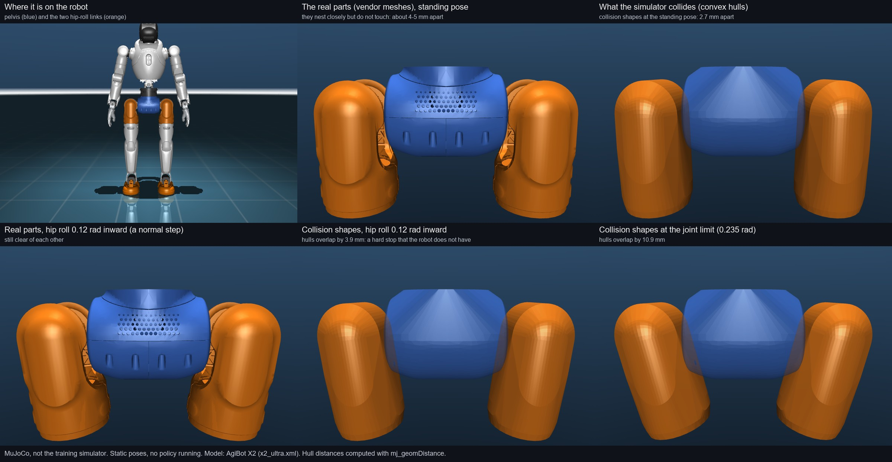
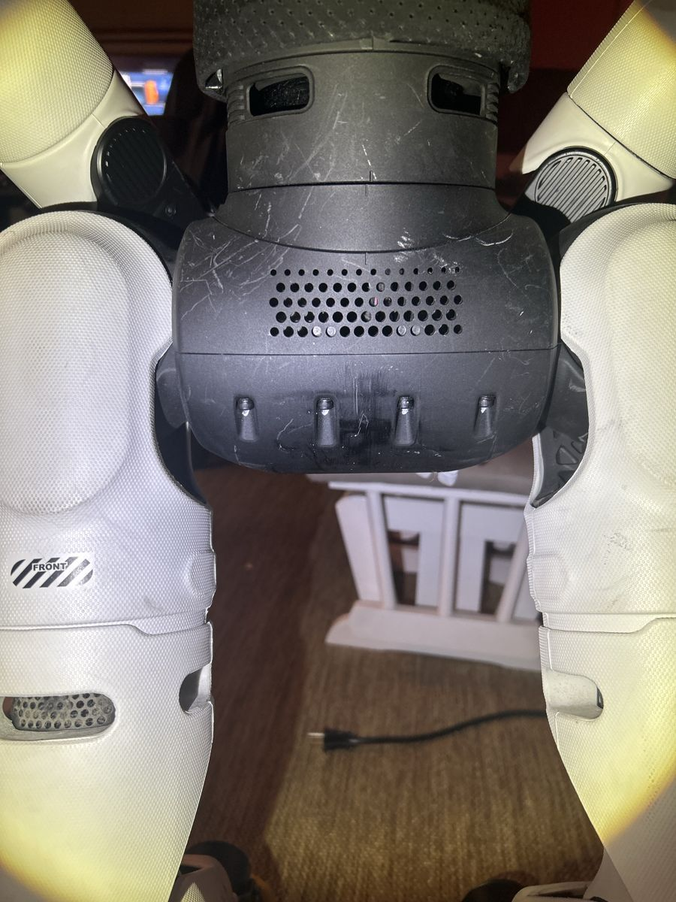
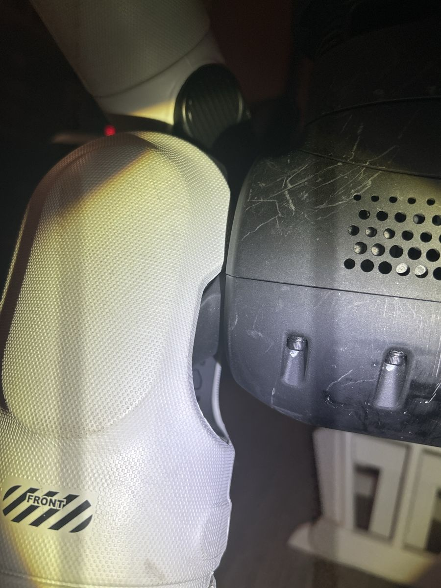
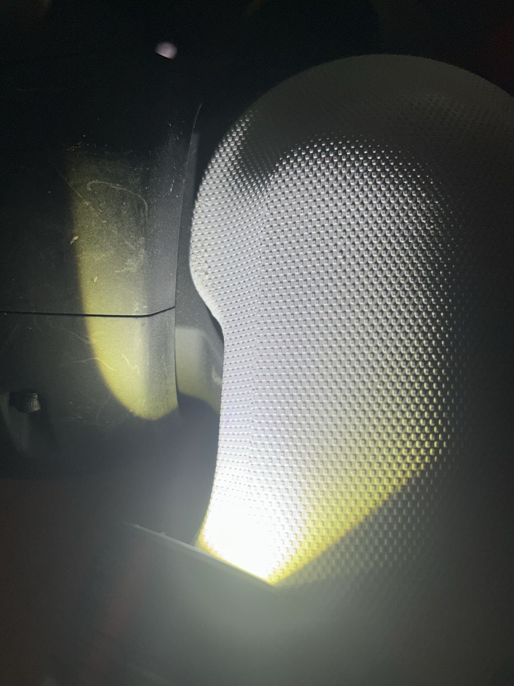
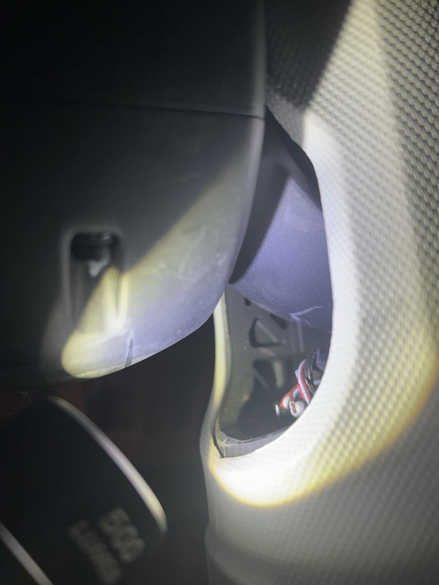
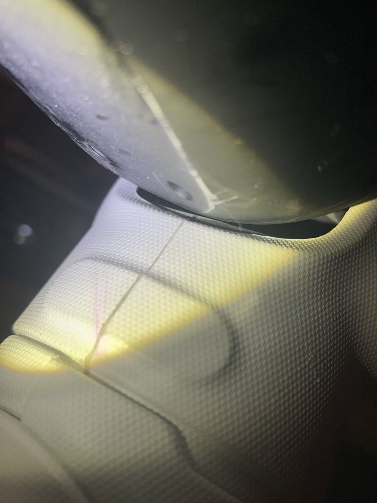
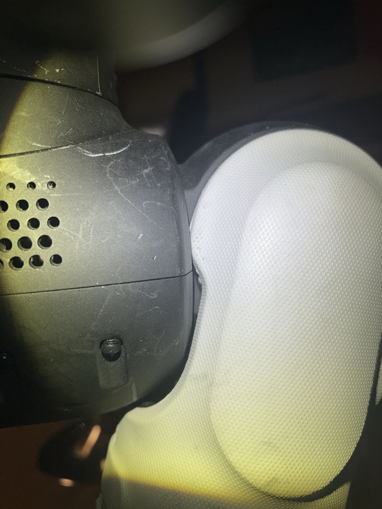
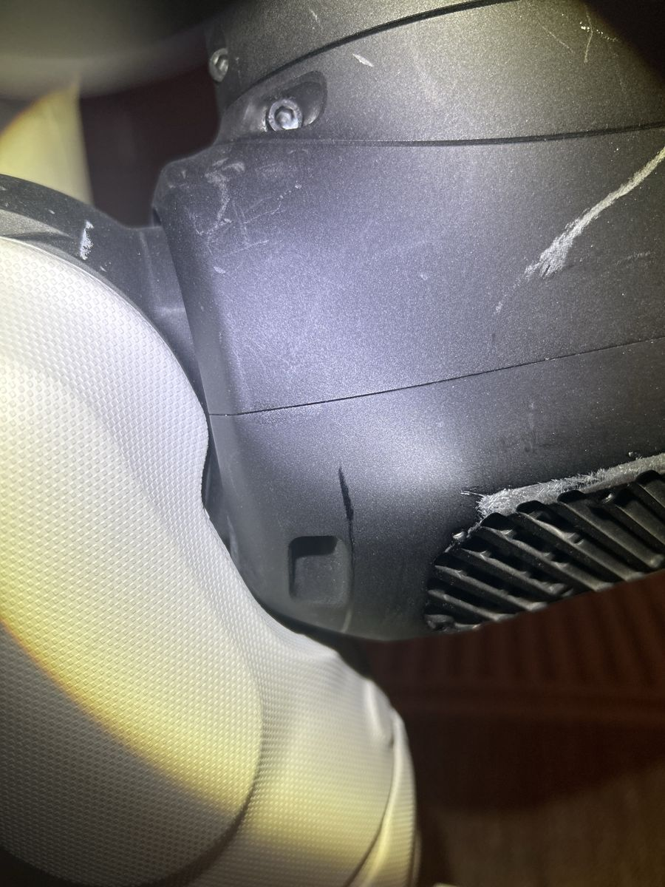

# False hip contact: the pictures

Finding A1 in `docs/FINDINGS.md`. The simulator collided the convex hulls of the pelvis and each hip-roll link; the real
parts never touch.

## In the simulator

MuJoCo, not the training simulator. Static poses, no policy running. Model: AgiBot X2 (`x2_ultra.xml`). Hull distance
between pelvis and hip-roll link: +2.7 mm standing, -0.6 mm at 0.06 rad inward, -3.9 mm at 0.12 rad, -10.9 mm at the
0.235 rad joint limit (negative = overlap).

## On the real robot (user's photos, 2026-11-12)

Legs hanging apart:

| Front | Right side | Gap | Into the recess |
|---|---|---|---|
|  |  |  |  |

Leg pushed inward:

| From below | Side | Rear |
|---|---|---|
|  |  |  |

Test by the user with the leg held at its inward stop: "a playing card nicely slides all around without being blocked".
The parts do not touch; the joint is the stop.
