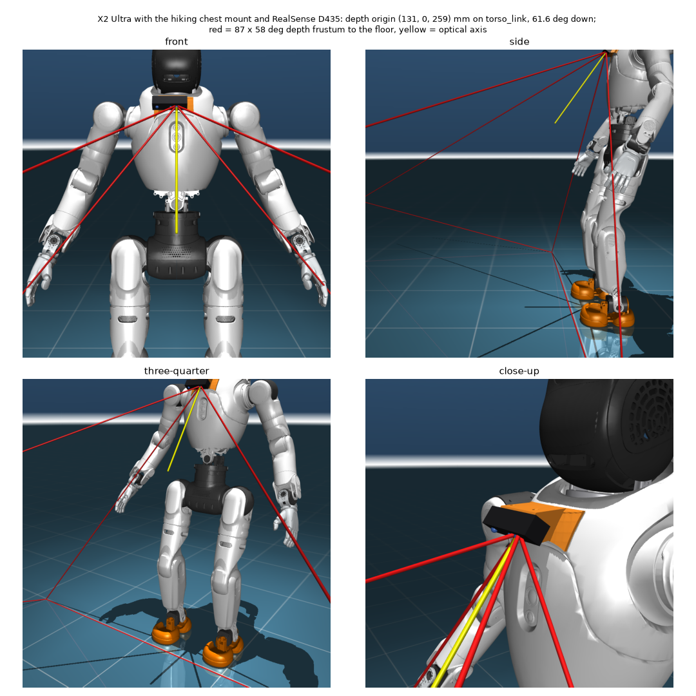
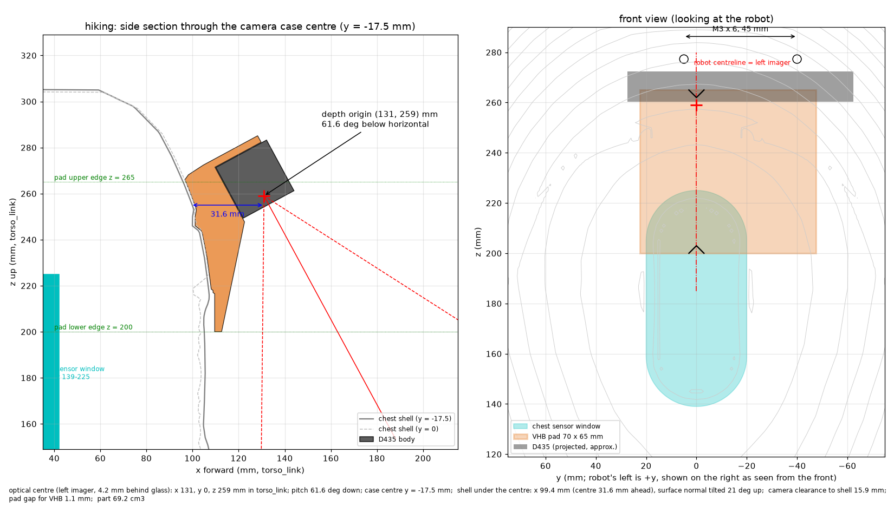
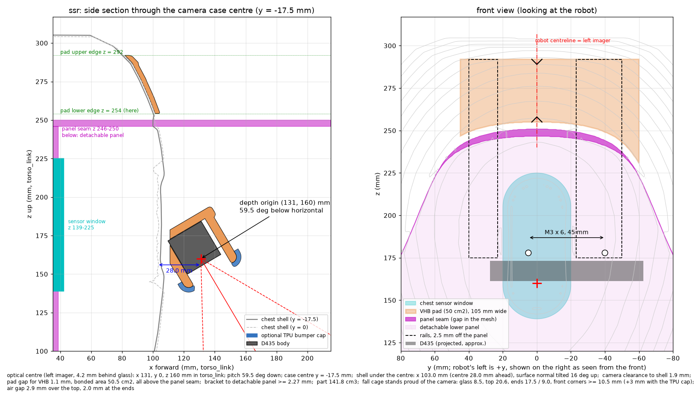
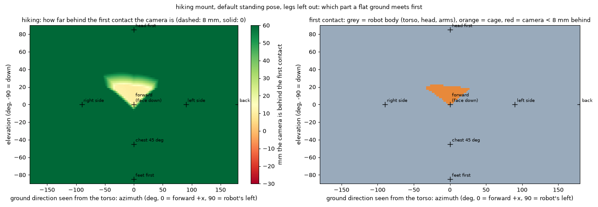

# Chest depth-camera mount for the AgiBot X2 Ultra (Hiking and SSR policies)

A 3D-printable bracket that holds an Intel RealSense D435 / D435i on the X2 Ultra's chest at the camera pose our released
Hiking-in-the-Wild and SSR policies were trained with. It sticks to the chest shell with double-sided foam tape (3M VHB); no
drilling. The underside follows the shell's shape (taken from the X2 Ultra torso mesh). The tape goes only on the fixed upper
chest shell, above the seam of the detachable lower chest panel (user, 2026-11-15: the panel is removable, so tape on it may
not hold). The pad's lower edge follows the seam 4 mm above it, which also locates the part.

| Policy | Needs this mount | File to print |
|---|---|---|
| Hiking in the Wild (X2 port, `release/hf/x2-hiking-in-the-wild`) | yes, variant **H** | `chest_mount_hiking_print.stl` |
| SSR (X2 port, `release/hf/x2-ssr`) | yes, variant **S** | `chest_mount_ssr_print.stl` |
| ACP | no (it uses no camera) | - |

**One mount does not fit both policies.** The two policies were trained with the camera 99 mm apart in height. SSR's training
moved its camera by at most 50 mm in height, so it never saw the Hiking position. Print the variant for the policy you run.
(Hiking's training moved the camera between 105 mm lower and 50 mm higher. The SSR position, 99 mm lower, is therefore at the
very edge of what Hiking saw. Do not plan on that.)

The SSR paper mounts its camera at the waist. Our SSR port was trained with this chest camera (`--camera chest_rs`), so use the
chest mount for our SSR checkpoints, not the paper's waist mount.

## Simple version (no cage, no supports) - 2026-11-16

For a printer that struggles with supports: `simple_mount_hiking_print.stl` (built by `simple_mount.py`; numbers in
`simple_mount_summary.json`, picture `simple_mount.png`). One solid four-sided block, 70 mm long, 18 cm3 (about 22 g):

- **Camera face** (flat, 15 x 70 mm): tape the rear 15 mm of the D435's underside to it (3M VHB, 1.1 mm). The camera's
  back-bottom edge sits flush with the block's upper front edge; the lens hangs forward of the block and looks down.
- **Chest face** (follows the chest, about 20 x 70 mm, 13.6 cm2 of tape): from about 256 to 275 mm up on torso_link, at
  least 5 mm above the panel seam, so it is only on the fixed upper shell. The block is centred 17.5 mm to the robot's
  right of the centreline (the left imager then sits on the centreline).
- **Print** lying on the camera face (the STL is already oriented): 31 x 70 mm on the bed, 22 mm tall, steepest wall 38 deg,
  no supports. PLA or PETG, 4 walls, 30 % infill, a 5 mm brim helps.
- Same camera pose as training, checked against the 24,500 export (`run_params/env.yaml` scene.camera.offset and
  `adapter_card.json` depth): torso_link, depth origin (0.131, 0, 0.259) m, quat wxyz (0.859, 0, 0.512, 0) = 61.6 deg down,
  no roll or yaw. The training camera follows the full torso pose (InstinctLab's GroupedRayCasterCamera forces
  attach_yaw_only = False and uses body pose x offset), so a rigid chest mount matches it. Training randomised the pose
  by +-20 mm forward, -105/+50 mm height, +-4 deg pitch, +-2 deg roll and yaw; aim well inside that (a few mm, 1-2 deg)
  and check with a flat-floor depth frame against `expected_depth_hiking.png`. No fall protection: use a
  tether, and keep a hand near the camera for the first tests.

## The trained camera pose

The pose is the camera's depth origin (the centre of the left infrared imager, 4.2 mm behind the front glass) in the
`torso_link` frame (x forward, y left, z up). The optical axis is pitched down about y. There is no roll and no yaw.

| | Hiking | SSR |
|---|---|---|
| Source | `release/hf/x2-hiking-in-the-wild/adapter_card.json` `depth`; `env.yaml` `scene.camera.offset` | `release/hf/x2-ssr/adapter_card.json` `observation.depth`; `models/ssr/code/ssr/x2.py` `chest_rs` |
| Position x, y, z (mm) | 131, 0, 259 | 126, 0, 160 (trained); **131, 0, 160 as built** (see below) |
| Pitch down from torso horizontal | 61.6 deg (quaternion wxyz 0.85896, 0, 0.51204, 0) | 59.5 deg (1.0385 rad) |
| Roll, yaw | 0, 0 | 0, 0 |
| Field of view | 87 x 58 deg (pinhole) | 87 x 58 deg (pinhole) |
| Image the policy sees | 64 x 36 raw; columns 16-47 cropped -> 36 x 32; Gaussian blur 3 x 3, sigma 1; 0-3 m / 3; stack of 8 frames, every 5th frame of 50 Hz (0.7 s) | 36 x 36 over the full 87 x 58 deg; z clipped to 0.1-3.0 m and scaled to 0-1; one frame per step (the GRU is the memory) |
| Depth value | z (distance along the optical axis), not ray length | z (distance along the optical axis) |
| Rate | 50 Hz; the newest frame is one control step old | 50 Hz, no delay |
| Mount randomisation in training | height -105 / +50 mm, forward +-20 mm, pitch +-4 deg, roll and yaw +-2 deg (per `models/hiking/LEDGER.md` note 3) | forward +-20, lateral +-10, height +-50 mm; pitch +-4, roll and yaw +-2 deg; FOV +-1 deg |

The SSR position is built 5 mm further forward than trained. At exactly 126 mm the camera's lower back edge would sit 3.1 mm
inside the chest shell. The trained pose was never checked against the real camera body. The 5 mm offset is well inside SSR's
+-20 mm forward randomisation. Pitch, height and the centreline are as trained.

How the two poses relate: both come from the user's infrared frame of a RealSense held on the chest (`docs/camera/README.md`).
Hiking's pose sits just above the sensor window, where that frame was taken. SSR's code comment calls its mount point
"PROVISIONAL ... until the Hiking track fixes the X2 offset". It was never updated, and SSR trained with it.

### Where that is on the chest (X2 Ultra torso mesh)

From `torso_plus_link.STL`, the mesh the X2 Ultra MJCF uses (`shell_heightmap.npz` keeps the ray-cast result):

| | Hiking | SSR |
|---|---|---|
| Chest surface straight behind the depth origin (x, mm) | 99.4 at z 259 | 103.0 at z 160 (inside the window recess; the rim is at 107) |
| Depth origin ahead of the surface | 31.6 mm | 28.0 mm (as built) |
| Surface normal there | tilted 21 deg upward (0.935, 0, 0.355) | tilted 16 deg upward |
| Side-to-side curvature | radius about 150 mm (3 mm sag over 60 mm) | flat apart from the window recess |
| Feature nearby | 34 mm above the top of the sensor window, 8 mm above the panel seam (z 247-251 mm on the centreline) | in front of the lower end of the sensor window, on the detachable panel |
| Smallest gap from camera body to chest | 15.9 mm | 1.9 mm |

The chest sensor window is a vertical capsule on the robot's centreline, about 40 mm wide (|y| <= 20 mm) and from z = 139 to
225 mm. Its glass is recessed about 4 mm below the surrounding rim.

**Panel seam (detachable lower panel).** In `torso_plus_link.STL` the chest front is two separate pieces: a lower piece
(z 38-247 mm, carrying the sensor window; the user says it is detachable) and the upper torso shell (z 139-374 mm, wrapping
over the shoulders and the top). Between them is a real gap in the mesh: rays cast from the front pass straight through to the
back shell. `panel_seam()` finds it per y and caches it in `shell_heightmap.npz`; `mount_summary.json` `panel_seam` lists it.
The seam is an arch (top of the lower panel / bottom of the upper shell): z 246.8 / 251.0 mm on the centreline, 244 / 248 at
|y| = 30, 241 / 244 at |y| = 40, 235 / 237 at |y| = 50, 223 at |y| = 60, 200 at |y| = 70 and 177 at |y| = 80. The upper shell
sits 2.5 mm behind the panel at the seam (x 100.7 vs 103.2 mm on the centreline). Uncertain: the mesh shows where the pieces
meet, not how they are fixed. That the lower piece is the removable one is the user's observation; the mesh cannot show it.
No other groove was found in the bond area (z 230-292).

## The bracket

- **Camera:** Intel RealSense D435 or D435i, 90 x 25 x 25 mm. It is held by its two rear M3 mounting points, which are 45 mm
  apart with a 3 mm maximum thread depth. It sits in an L-shaped cradle: a 4 mm floor under the camera and a 3.2 mm wall behind
  it, with 0.3 mm clearance. The cradle sets the pitch. Since 2026-11-15 a fall-protection cage closes the cradle into a box
  that is open at the front (see [Fall protection](#fall-protection)). The camera slides in from the front.
- **Lateral offset:** the depth origin is the left imager, 17.5 mm from the camera's centre. The bracket therefore places the
  camera body 17.5 mm toward the robot's right (y = -17.5 mm), so that the left imager is on the robot's centreline, as in
  training.
- **Screws:** two M3 x 6 (ISO 4762 or ISO 7380), driven from behind the wall through a 6.5 mm access channel. Do not use
  longer screws: 3.2 mm of wall plus 2.8 mm of thread is the camera's 3 mm limit.
- **Pad (the same for both variants):** only on the fixed upper shell. It spans y = -60 to +45 mm. The upper edge is at
  z = 292 mm (the shell rounds over to the shoulder top at about z 300). The lower edge follows the seam 4 mm above it: z 255 on
  the centreline, 254 at |y| = 20, 249 at y = -40, 247 at y = +45, 231 at y = -60. Bonded area 50.5 cm2 on the curved shell.
  The underside is the shell offset by 1.1 mm for the tape, measured normal to the shell (the shell tilts back up to about
  45 deg near the top edge).
  Before 2026-11-15 the pads were 70 x 65 mm (H, z 200-265) and 70 x 67 mm (S, z 105-172). H bonded 38.8 cm2, of which only
  12.4 cm2 was on the fixed shell and 23.4 cm2 on the detachable panel. S bonded 35.4 cm2, all of it on the panel.
- **Clear of the panel:** every bracket surface away from the bonded area stays at least 2.5 mm from the shell (the shell grown
  by a 2.5 mm ball, so the panel's lip at the seam counts too). Measured against the mesh: H is 4.3 mm from the panel (no part
  of H is below the seam); S is 2.3 mm from the panel and its window inserts.
- **H (Hiking):** the camera sits just below the pad, so one solid web joins the cradle to the middle of the pad.
- **S (SSR):** the camera is 90 mm below the seam, in front of the detachable panel. Two rails (y = -50 to -23 and +23 to
  +40 mm, 8 mm thick, 2.5 mm off the panel) run from the cradle up to the pad, with a gusset into the cradle wall on each side.
  The rails leave the sensor window (|y| <= 20) uncovered. The camera body itself is 1.9 mm from the window rim (as before;
  the camera is not taped there and does not touch).
- **Head:** the head (yaw and pitch links, over their full range) stays at least 29.9 mm (H) or 30.6 mm (S) from the bracket,
  the TPU cap and the camera. Before the cage it was 30.6 mm for both.
- **Arms:** at the default standing pose the arms are at least 98 mm from the mount (right arm; left arm 113 mm).
- **Field of view:** checked in `build_mount.py`. No point of the bracket or TPU cap is inside the 87 x 58 deg depth view with
  the training's +-4 deg mount randomisation added, nor inside the IR imagers', IR projector's or RGB camera's own cones. See
  [Fall protection](#fall-protection) for the margins.
- **Cable:** each cheek of the cage has a 16 x 12 mm window (rounded corners) centred on the camera's end face for the USB-C
  plug, because which end has the port is not confirmed. Plug overmoulds larger than about 15 x 11 mm will not pass; file the
  window larger if needed.
- **Alignment:** no notches (removed 2026-11-15; they printed as odd dents). The pad's lower edge runs parallel to the seam,
  4 mm above it; the camera opening is centred 17.5 mm right of the robot centreline (the left imager sits on it).

### Files

| File | What |
|---|---|
| `chest_mount_hiking_print.stl`, `chest_mount_ssr_print.stl` | Ready to slice, in the orientation with the least overhang (mm). |
| `chest_mount_*_robot_frame.stl` | The same parts in the `torso_link` frame (mm), for CAD or simulation |
| `chest_mount_*_tpu_bumper_print.stl`, `chest_mount_*_tpu_bumper_robot_frame.stl` | Optional TPU cap for the cage's front rim (see [Fall protection](#fall-protection)) |
| `fall_coverage_*.png` | For every direction the ground can come from: which part of the upper body touches first and how far behind it the camera is |
| `build_mount.py` | Parametric source: poses, camera data, pad size, tape thickness, clearances. Rebuilds the STLs, drawings, renders and expected depth images. Needs numpy, scipy, trimesh, manifold3d, matplotlib and mujoco. Uses `shell_heightmap.npz` (shell and seam), so the torso mesh is only needed to re-ray-cast and for the exact clearance checks. Pass the robot assets with `--mesh`, `--mjcf` and `--meshdir`, or set `X2_ASSETS` to the robot assets folder. |
| `mount_summary.json` | All numbers: panel seam, poses, hole positions, pad edges and bonded area, clearances (to the shell, the panel, the head and the arms), volumes, print orientation, render pose; under `cage`: dimensions, how far the cage stands proud of the camera, view-cone margins, air gaps, TPU cap; `fall_named` and `fall_coverage`: the fall-direction check |
| `drawing_*.png` | Dimensioned side section and front view |
| `render_*.png` | MuJoCo renders (front, side, three-quarter, close-up, and two close-ups of the cage with the arms and head hidden) with the depth frustum to the floor |
| `expected_depth_*.png` / `.npy` | Simulated depth image on flat ground at the standing pose, for the check below |

CadQuery is not installed on this machine. The part is built in Python with manifold3d booleans instead, because the conformal
pad comes from the mesh, which OpenSCAD cannot read sensibly.

## Fall protection

Added 2026-11-15 at the user's request: "can you add some protect on top of the camera? because the robot will fall to the
ground, and i dont want the camera to be the first one to break up into pieces". Edges rounded the same day ("can you smoothen
the edges and corners?"). The camera pose did not change.

**Geometry.** The cradle is closed into a box around the camera, open only at the front (bottom-right close-ups in
`render_*.png`, side section in `drawing_*.png`):

| Member | PETG thickness | Air gap to the camera |
|---|---|---|
| Roof over the camera's top face | 5.5 mm | 3 mm |
| Cheek at each end (with the USB-C window) | 7 mm | 2 mm |
| Floor under the camera (cage part) | 5.5 mm (cradle part 4 mm) | 0.3 mm (seat face) |
| Back wall | 3.2 mm (set by the M3 x 6 screws), backed by the web (H) or the gussets and rails (S), now up to the roof | 0.3 mm (seat face) |

The front ends of roof, cheeks and floor form a rim 8.5 mm ahead of the cover glass. The opening is the camera's cross-section
plus the gaps (94 x 28 mm), so the glass sits 8.5 mm back from the rim, uncovered.

**Load path.** The cage touches the camera only on the two faces the cradle always seated it on (floor and back wall). Roof and
cheeks keep their air gaps, so a blow on the rim or roof goes through the box walls into the back wall and from there into the
web and pad (H) or the gussets and rails (S), not through the camera body or its M3 screws. The screws only hold the camera's
own inertia. This is a description of the geometry. No impact or strength analysis was done.

**How far it stands proud of the camera.** This is the distance a flat surface coming from that direction still has to travel
after it touches the bracket before it reaches the camera. From `mount_summary.json`, `cage.proud_of_camera_mm`:

| Direction | H | S | with TPU cap |
|---|---|---|---|
| Glass face (along the optical axis) | 8.5 | 8.5 | 11.5 |
| Camera top face | 10.5 | 20.6 | 11.5 (H) |
| Left / right end | 17.5 / 9.0 | 17.5 / 9.0 | 17.5 / 12.0 |
| Four front corners (glass corners) | 12.1-18.9 | 10.5-12.1 | +3 |
| Glass top / bottom edge | 10.3 / 24.9 | 10.4 / 8.4 | +3 |
| Robot lying face down (torso +x) | 10.1 | 10.2 | 13.1 / 13.2 |
| Worst direction over the half sphere facing the camera's front and top | 8.3 | 8.5 | 8.3 / 10.1 |

The other half of the sphere faces the chest, which covers it. The left end stands 17.5 mm proud because of the tether ear.

Why at least 8 mm: it is a judgment, not a calculation. It leaves room for the printed rim to bend or crack, and for the TPU
cap to compress, before anything reaches the camera. It is also about as far as the rim can stand out before it reaches the
right imager's and the projector's view cones. What it does not stop: a flat surface cannot reach the glass, but a stone or
stick narrower than the opening can. A ball of radius under about 16 mm (about 14.5 mm with the TPU cap) pressed into the
opening reaches the glass. A grille would stop that, but it would sit in the view.

**Which falls it covers.** The check is `fall_coverage_*.png` and `fall_named` / `fall_coverage` in the summary: the robot is
rigid in the default standing pose (arms hanging), the legs are left out, and a flat ground comes from each direction. For each
direction it finds which part of the torso, head, arms or mount touches first, and how far behind that the camera is.

- **Face down (chest-first, torso near horizontal), and sliding face down:** the cage touches first, with the camera 10.1 mm
  (H) or 10.2 mm (S) behind it, or 13 mm with the TPU cap. This is the case the cage is for. On the map it is the patch of
  directions around "forward", within about 30 deg to each side and about 20 deg up.
- **Forward with the torso still at 45-60 deg from upright:** the lower front of the torso is ahead of the camera by 210 mm or
  more. In a real fall the knees or hands usually land first. That was not modelled.
- **Side falls (left, right, and forward-diagonal):** the shoulder and arm land first, 230-630 mm ahead of the camera. The
  cheeks still stand 9 mm or more proud of the camera ends.
- **Back falls:** the back of the torso lands first, 290 mm or more ahead of the camera. The camera cannot reach the ground.
- **All directions:** the upper body touches first for 98.2% (H) or 99.2% (S) of directions, and the cage for the rest. No
  direction puts the camera within 8 mm of the first contact.

Not covered: the arms moving in the fall (an arm under the chest takes the hit instead, which only helps); tumbling onto rocks,
kerbs or step edges, which can reach into the opening as above; the camera being torn off with the bracket (see the tether
below); and any check of whether the PETG survives.

**View cones.** Every cone below, 1 deg wider than listed, is cut out of the bracket and the cap. That bevels the rim where a
cone reaches it, mainly on the right cheek. The smallest angular margin of any bracket (or cap) point outside each cone, the same
for H and S:

| Cone (apex at the depth origin plane) | Half-angles used | Bracket | TPU cap |
|---|---|---|---|
| Depth frustum 87 x 58 + 4 deg training margin | 47.5 x 33 | 14.2 | 7.9 |
| Left IR imager (91.2 x 65.5 + 3 deg tolerance, 1 mm aperture) | 48.6 x 35.8 | 9.3 | 3.4 |
| Right IR imager, 50 mm to the right | 48.6 x 35.8 | 4.0 | 3.5 |
| IR projector, anywhere between the imagers (90 x 63 + 3 deg, 3 mm aperture) | 48 x 34.5 | 1.0 (cut) | 1.0 (cut) |
| RGB, if at +15 mm (69.4 x 42.5 + 3 deg) | 37.7 x 24.3 | 11.0 | 4.7 |

**Optional TPU cap** (`chest_mount_*_tpu_bumper_*.stl`). It is a 3 mm TPU (95A) shell over the front rim, with 6 mm skirts
back over the outer faces of the roof, cheeks and floor. It is 10 cm3, about 12 g. Slide it on and glue it with a flexible
adhesive (flexible CA or contact cement), because it does not clip. It adds 3 mm in front, on top and at the ends. It prints in
the `_print.stl` orientation with about 3 cm2 of overhang.

**Tether.** An ear on the outside of the left cheek, at its back-top corner, has a 4 mm hole along the camera's up axis. Tie a
thin cord (for example 2 mm Dyneema or paracord core) from it to a solid point on the torso. Leave only enough slack that a
detached bracket hangs against the chest and cannot reach the ground or swing into the arms. The tape peeling off is acceptable
as a fuse: in a hard hit, letting go is better than cracking the camera or the chest shell. The tether then catches the
bracket and camera, which is not left hanging on its USB cable. Check the tape after every hard fall, and re-tape with fresh
VHB if any edge has lifted. Which point on the X2 torso to tie to was not chosen.

**Rounded edges.** The cage is one box rounded with 4 mm radii on the front-rim corners and edges and 2.5 mm elsewhere. The
webs and gussets are grown by a 2 mm ball, which rounds their edges and makes them about 2 mm thicker. The SSR rails have
2.5 mm rounds on their outer long edges. The pad's outer perimeter has a 1 mm round. Small features get 1 mm: the rim's inner
edge (1.5 mm), the ear (1.5 mm), the USB windows (1 mm chamfer), the M3 holes at the seat face (1 mm chamfer) and the tether
hole (0.6 mm chamfer). Unchanged: the taped face (the shell offset by the 1.1 mm tape), the camera seat faces, the M3 holes and
the screw-head channels. The channel entrances in the web are still sharp. With rounding, the bracket is
140.8 / 141.8 cm3 (H / S); without it, 129.1 / 130.5 cm3. The 2 mm growth of the webs outweighs what the rounds remove. All
STLs are watertight single bodies.

## Printing

- **Material:** PETG or ASA. Avoid PLA, which creeps and softens in a warm robot or in the sun.
- **Orientation:** as in the `_print.stl` file, chosen by `build_mount.py` for the least overhang: H on its right side (the
  right cheek on the bed), S standing on the pad's flat top edge. With the cage, about 27 cm2 (H) or 25 cm2 (S) of overhang
  remain (the curved pad and web, the cage opening, the screw channels). Use supports touching the build plate only, keep them
  off the pad's taped face if the slicer allows, and clean the two camera seat faces (floor and back wall) afterwards.
- **Settings:** 0.2 mm layers, 5 perimeters, 40-50% gyroid infill. The cage walls are thin enough that most of them print
  solid. The solid volume is 141 cm3 (H) or 142 cm3 (S), which is 179 or 180 g of PETG at 100% (68 and 73 cm3 before the
  cage). The TPU cap is 10 cm3 (12 g). The camera adds 72 g.
- **After printing:** run a 3.4 mm drill through the M3 holes if they are tight. Check that the camera sits flat on both cradle
  faces with no rocking.

## Mounting

1. Screw the camera into the bracket first (two M3 x 6). Take the screws to snug only; the camera's inserts are shallow.
2. Dry-fit. Put the pad on the upper chest so that its curved lower edge runs parallel to the panel seam, about 4 mm above
   it, with no part of the pad below the seam. Centre it side to side: the left imager (the lens nearest the robot's left) sits on the sensor window's vertical centreline; mark the centreline on the masking tape first. For S, the
   rails must not touch the lower panel or the window. The camera must be level side to side and its glass must face forward
   and down. Outline the pad with masking tape.
3. Clean the chest area and the pad underside with isopropyl alcohol (3M recommends a 50:50 mix with water) and let them dry.
   Work at room temperature (above 15 C).
4. Apply 3M VHB 5952, 1.1 mm thick (or a similar 1.1 mm VHB for painted and low-energy plastics), to the pad only (not to the S
   rails). Peel the liner, place the pad within the masking-tape outline, and press firmly (about 1 kg/cm2) for 30 s.
5. Wait before walking: the tape reaches about 50% strength in 20 min, 90% in 24 h and 100% in 72 h. Tie the tether from the
   ear on the left cheek to the torso (see [Fall protection](#fall-protection)). Fit the optional TPU cap before mounting.
6. Route the USB-C cable from whichever end has the port, and strain-relieve it on the torso. Use a USB 3 port.
7. **Check the pitch with a phone inclinometer.** Put the phone edge on the camera's top face, which is parallel to the optical
   axis. With the torso level (the robot hanging in its gantry, torso pitch about 0 on the robot's IMU), it should read
   **61.6 deg (H)** or **59.5 deg (S)** below horizontal. If the torso is not level, subtract the torso's own forward pitch.
   Aim for +-1 deg.

Removal: cut the tape with fishing line or dental floss, then use an adhesive remover. It can mark the paint.

## Checking it in software

Errors that matter, in order:

1. **Pitch.** One degree moves the far edge of the image about 0.1 m along the floor, and it changes every far row. Keep it
   within +-1 deg. Training covered +-4 deg, but the policies are best near the centre.
2. **Roll and yaw.** These tilt or turn the floor in the image. Keep them within +-1 deg (training +-2 deg).
3. **Height.** Keep it within +-5 mm of the drawing. Training covered tens of mm, but both offsets add up.
4. **Lateral offset.** The left imager, not the camera's centre, must be on the centreline. Getting this wrong puts the camera
   17.5 mm off; SSR trained only +-10 mm.
5. **Image orientation and depth type.** Row 0 is the image top (far). Column 0 is the robot's left. The depth value is z along
   the optical axis, not ray length. These are the stream's native conventions, so do not flip or rotate the image.

Procedure:

1. Stand the robot on a flat, plain floor in the policy's default pose, or hang it in the gantry with the soles on the floor.
2. Record depth: 848 x 480 at 60 fps, depth units 1 mm, emitter on, auto-exposure. Use the "Default" or "High Accuracy" preset.
3. **Plane fit.** Fit the floor plane to the point cloud (RANSAC). Its normal gives the camera's pitch and roll relative to the
   floor, and its distance gives the camera height. The mount pitch is the camera pitch minus the torso pitch from the robot's
   IMU. It should come out at 61.6 deg (H) or 59.5 deg (S), with roll about 0.
4. **Image comparison.** Run the frame through the policy's own preprocessing: resample the full 87 x 58 deg frame to 64 x 36
   (H) or 36 x 36 (S) with nearest or min pooling; then crop, blur, clip and scale as in the pose table. Compare it row by row
   with `expected_depth_hiking.npy` (raw 64 x 36, metres) or `expected_depth_ssr.npy` (36 x 36, metres).
   - Those images were made at the Hiking default joint pose with flat soles: torso leaning back 7.4 deg, camera 1.09 m (H) or
     0.99 m (S) above the floor, optical axis 54.2 deg (H) or 52.1 deg (S) below horizontal. They match the reference frame in
     `docs/camera/README.md` (53 deg).
   - A row-median difference that grows steadily from the bottom row to the top is a pitch error. A difference that changes from
     left to right is roll or yaw.
   - The eval adapters (`eval/adapters/hiking.py`, `eval/adapters/ssr.py`) build the same image from MuJoCo for any pose.

Camera settings matching training:

- **Stream:** depth only (the policies do not use colour or infrared), 848 x 480, at least 60 fps. Hand the policy the newest
  frame at each 50 Hz step. Hiking expects the frame one control step old and keeps its own 37-frame history.
- **Range:** 0.1-3 m. Training images have no holes, because the simulator ray-casts. Fill zero (invalid) pixels before
  pooling: use hole filling (the "nearest from around" option) and a light spatial filter. As a last resort, set an invalid
  pixel to the far value (3 m), which is what the training clip does for beyond-range pixels.
  - A temporal filter adds lag. Hiking's frame stack assumes none, so leave it off or keep it very light.
- **Decimation:** do not use the decimation filter if you resample to the policy's size yourself.

## Uncertain or not checked

- **Mesh against the real robot:** the chest shape comes from the vendor torso mesh (`torso_plus_link.STL`, md5
  `f080a9b2...`), not from a scan. Panel seams, paint and production tolerance are not in it, so expect up to about 1 mm of
  misfit. The 1.1 mm foam tape absorbs that. Hiking was trained in Isaac Lab from the X2 USD. Its torso frame is assumed to equal
  the MJCF `torso_link` frame.
- **Camera values:** from the Intel RealSense D400 Series Datasheet, document 337029-005.
  - Size: Table 3-44 (90 x 25 x 25 mm, 72 g).
  - Depth start point: Table 4-13 (4.2 mm behind the front glass for the D435/D435i).
  - Left imager offset: Table 4-15 (17.5 mm from the centreline of the 1/4-20 tripod hole).
  - Mounting: Figure 10-8 (2x M3 rear mounting points 45 mm apart, maximum insertion 3 mm).
  - Not dimensioned in the drawing, and assumed from it: the M3 holes are symmetric about the tripod centreline, at the
    camera's mid-height. Also assumed: the camera body is a sharp-edged box (the real one has rounded edges, so it only gains
    clearance).
  - Check the first print with the real camera.
- **USB-C port:** which end it is on was not confirmed, so both cheeks have a 16 x 12 mm window centred on the end face. The
  port's exact position on the end face and the plug overmould size were not checked. Try the plug in the first print.
- **SSR pose:** built 5 mm forward of the trained pose (see above). The camera hides the lower half of the chest sensor window
  in variant S. Variant H no longer covers the window.
- **Panel seam:** taken from the mesh only (see above). On the real robot, check before taping that the pad's lower edge clears
  the seam. Which piece is removable, and whether the upper shell itself is rigid, was not checked.
- **S stiffness:** the S camera hangs about 80 mm below the pad on two 8 mm PETG rails. Not analysed or tested. If it wobbles,
  print with 100% infill or in a stiffer material.
- **Toe tips:** in the expected images the toes fall about 2 cm outside the bottom edge. The user's reference frame shows them
  just inside. This depends on how far the real robot leans when standing, and the plane-fit check above settles it.
- **Strength:** VHB strength under falls was not tested. The cage roughly doubles the bracket's mass (about 180 g solid
  instead of 86 g, plus the 72 g camera), so the tape carries more in a hit. No impact or strength analysis was done for the
  cage, the tape or the tether ear.
- **D435 view cones:** the IR imager (91.2 x 65.5 deg) and projector (90 x 63 deg) fields of view are as read from the
  datasheet, and the projector's position is not dimensioned there. The check therefore allows it anywhere between the imagers.
  The lens apertures (1 mm imagers, 3 mm projector) are estimates. The projector cone is what limits the right cheek (1.0 deg,
  as cut). Confirm on the first print that the depth image shows no rim at its right edge.
- **Fall check:** geometric only, as described under Fall protection: rigid default pose, legs left out, flat ground.
